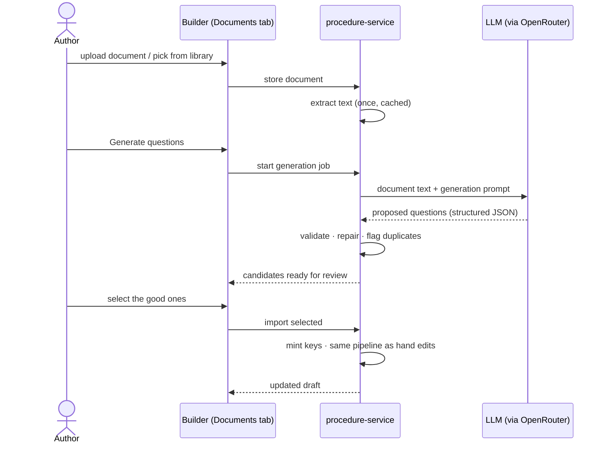

# AI Question Generation — How It Works

*Sclera 2.0 · procedure-service · last updated 2026-10-13*

This document explains how Sclera turns **documents** (standards, SOPs) and
**chat conversations** into inspection checklist questions. It is written for a
non-technical reader first; the technical appendix at the end is for engineers.

---

## What the feature does, in one paragraph

An author building an inspection procedure can upload a standard (say, NFPA 10
for fire extinguishers) or simply describe what they want in chat. The AI reads
the source and proposes checklist questions — each with its answer type, its
Pass/Fail mapping, and a pointer back to the sentence it came from. **Nothing
the AI produces enters a checklist by itself.** Every suggestion sits in a
review list until a human selects it, and only then is it added to the draft —
through exactly the same validation a hand-typed question goes through.

---

## The two ways in, the one way through

```mermaid
flowchart LR
    A[Upload a document\nPDF / DOCX / TXT] --> C[AI generates\ncandidate questions]
    B[Chat with the assistant\n"add three checks for..."] --> C
    C --> D[Review list\nhuman selects / discards]
    D --> E[Import into the draft\nsame validation as hand edits]
    E --> F[Draft → Publish → Inspections]
```

There are two *sources* (document, chat) but only one *entry point* into a
procedure: the import step. This is a deliberate design decision — it means the
AI can never bypass the rules that apply to a human author.

---

## Flow 1: Questions from a document

**Step by step, as the user experiences it:**

1. **Upload or reuse.** In the procedure builder's *Documents* tab, the author
   uploads a PDF, Word or text file — or picks one from the **document
   library**, which keeps every document the organization has ever uploaded.
   A document is stored once and can be reused any number of times: generating
   questions again from last month's SOP is a two-click operation, with no
   re-upload.

2. **Text extraction.** The service extracts the plain text in the background
   (PDFBox for PDFs, Apache POI for Word). This happens **once per document** —
   the text is cached, so re-generation later skips straight to step 3.

3. **Generation job.** The author clicks *Generate questions*. The service
   splits long documents into chunks and sends each chunk to the AI model with
   a carefully written prompt: *"propose inspection questions; for each one,
   give the answer type, whether it is required, the standard it comes from,
   the exact source sentence, and your confidence."* This runs as a background
   job — the author can keep editing while it works.

4. **Validation and de-duplication.** Every proposed question is checked by
   our own code before it is stored:
   - structurally valid (a Yes/No question has Yes/No answers, a number
     question has sensible bounds, and so on) — broken ones are repaired where
     possible and rejected otherwise;
   - compared against questions the organization already has — near-duplicates
     are **flagged, not hidden**, so the reviewer sees "you already have one
     like this" next to the suggestion.

5. **Review.** The suggestions appear in a review dialog showing the question,
   its answers with Pass/Fail meanings, the source sentence from the document,
   the AI's own confidence score, and any duplicate warning. The author ticks
   what they want and can discard the rest.

6. **Import.** Selected questions are appended to the draft. At this moment —
   and not before — each question receives its permanent key from the
   procedure's own counter, exactly as if the author had typed it. The import
   is **idempotent**: importing the same suggestion twice adds it once.



---

## Flow 2: Questions from chat

The *Suggestions* tab opens a conversation scoped to the procedure being
edited. The assistant already knows the current draft, so the conversation is
about *this* checklist:

> **Author:** Add three checks for the pump room — one about the pressure
> gauge, one about leaks, and a number reading in psi between 100 and 400.
>
> **Assistant:** I've added three candidate questions: a yes/no check on the
> pressure gauge, a yes/no check for leaks, and an integer reading for gauge
> pressure in psi (100–400). Please review them.

Each turn can **add** new candidates, **revise** earlier ones ("make question 2
required"), or **remove** them ("drop the leak check") — all still candidates,
all still awaiting the same review-and-import step as document suggestions.
The conversation history is kept, so the author can refine over several turns
before importing anything.

---

## What keeps this safe and auditable

| Safeguard | What it means in practice |
|---|---|
| **Human in the loop** | No AI output reaches a checklist without an explicit human selection. |
| **One import path** | AI imports use the identical validate → mint-keys → save pipeline as manual editing. There is no second, weaker path. |
| **The AI never mints keys** | Question keys (the stable identity inspections depend on) come from the procedure's own counter at import time, never from the model. |
| **Nothing unvalidated is stored** | A suggestion that fails structural validation is rejected before it is ever saved. |
| **Provenance on every question** | Each candidate records its source (which document and sentence, or which chat turn), the model used, and the AI's confidence. |
| **Duplicate awareness** | Suggestions resembling existing questions are flagged for the reviewer, not silently added or silently dropped. |
| **Versioning untouched** | Imports land in the *draft*. The published version — what inspectors actually run — only changes when a human publishes. |
| **Cost tracking** | Every generation job records the model and token counts, so AI spend is attributable per job. |
| **Feature flag** | The whole feature sits behind `AI_QUESTION_GENERATION_ENABLED`. Switched off, the endpoints do not exist and the UI hides the panels. |

---

## The document library

Documents are organizational assets, not throwaway uploads:

- every uploaded document is stored with its extracted text and is visible in
  the **Documents** dialog (library page) and the **From library** picker
  (builder);
- questions can be **re-generated** from any stored document at any time —
  each run is a new job with its own audit trail, and extraction never re-runs;
- a procedure can be **created directly from documents**: pick up to five in
  the library and the new procedure's builder opens with them pre-loaded.

---

## Technical appendix (for engineers)

### Components

| Piece | Responsibility |
|---|---|
| `AiDocumentService` | Document lifecycle: store → extract (async) → READY/FAILED → list. |
| `DocumentExtractionService` | PDF/DOCX/TXT → plain text; chunking for long documents. |
| `QuestionGenerationService` | The two entry points: document jobs and chat turns. |
| `GenerationJobRunner` | Executes a job: chunk → prompt → LLM → map → dedup → persist candidates. |
| `LlmClient` | The one place that talks to the model. OpenAI-compatible chat-completions endpoint (`sclera.ai.base-url`, OpenRouter by default); JSON schema derived from `LlmSchemas` is embedded in the system prompt with `response_format: json_object`; retries, timeout and token logging live here. |
| `CandidateMapper` | Deterministic repair + semantic validation of raw LLM output. |
| `DedupService` | Token-overlap similarity against existing questions (threshold 0.8). |
| `QuestionImportService` | THE shared import path: wraps the normal draft save; pre-mints option keys for follow-ups under the template lock; idempotent via `imported_key`. |

### Data model (tenant schema)

- `ai_document` — file bytes, extracted text (cached), status, error.
- `generation_job` — one row per document generation: status, model, token counts.
- `chat_session` / `chat_message` — conversation per procedure.
- `generated_question` — one candidate: key-less question JSON (validated
  before persisting), source + source span, confidence, similar-existing flag,
  status `DRAFT → IMPORTED | DISCARDED`, minted key + timestamp on import.

### API surface (behind the gateway, `/api/v1`)

| Endpoint | Purpose |
|---|---|
| `POST /ai/documents` | Upload (multipart); extraction runs in background. |
| `GET /ai/documents` | The organization's document library. |
| `GET /ai/documents/{id}` | Poll extraction status. |
| `POST /procedure-templates/{id}/generate/document` | Start a generation job (`documentId`, optional `instructions`, optional `model` bounded by the allow-list). |
| `GET /ai/generation-jobs/{jobId}` | Poll; candidates appear when COMPLETED. |
| `POST /procedure-templates/{id}/chat` | Open a chat session. |
| `POST /ai/chat/{sessionId}/messages` | One turn: message in, reply + updated candidates out. |
| `GET /procedure-templates/{id}/question-drafts` | Review list (filter by status). |
| `POST /procedure-templates/{id}/questions/import` | Import selected candidates (idempotent). |
| `POST /procedure-templates/{id}/question-drafts/{cid}/discard` | Reject a candidate. |

### Configuration

| Env var | Meaning | Default |
|---|---|---|
| `AI_QUESTION_GENERATION_ENABLED` | Feature flag | `false` (`true` in dev profile) |
| `OPENROUTER_API_KEY` | API key (checked lazily, on first call) | — |
| `SCLERA_AI_BASE_URL` | Any OpenAI-compatible endpoint | `https://openrouter.ai/api/v1` |
| `SCLERA_AI_MODEL` | Default model | `nvidia/nemotron-3-super-120b-a12b:free` |
| `SCLERA_AI_ALLOWED_MODELS` | What a request may override to | free Nemotron + `qwen/qwen3.8-flash` |
| `SCLERA_AI_CHUNK_CHARS` / `SCLERA_AI_MAX_CHUNKS` | Document chunking | 24 000 / 8 |

The model is a deployment decision, not a code decision: switching provider or
model is configuration. The current default is a free-tier model (rate-limited,
~50 requests/day); moving to a paid model is a one-line env change.

### Notes on long-running work

LLM calls take tens of seconds, so generation runs on a small dedicated
executor with the job row committed first — the worker re-reads it in a fresh
transaction and re-establishes the tenant context from explicitly passed ids.
Transactions are per-repository-call so no database connection is held across
an LLM round-trip.
